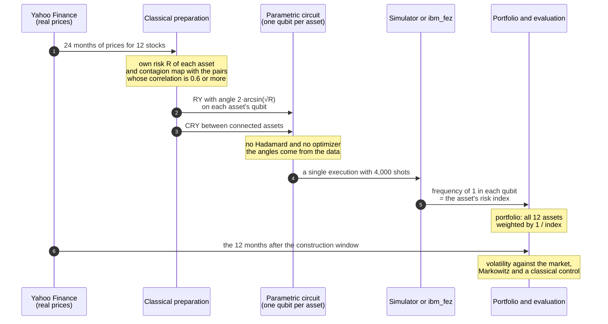

# Quantum Portfolio Risk

**English** · [Español](README.es.md)

[](LICENSE)
[](https://www.python.org/)
[](https://github.com/Qiskit/qiskit)
[](https://quantum.cloud.ibm.com)
[](#results-on-real-hardware)
[](https://frcu.utn.edu.ar/index.php/escuela-cacic/cursos-cacic)

**[Website](https://314-ia.github.io/quantum-portfolio-risk/en/)** · **[Notebook online](https://314-ia.github.io/quantum-portfolio-risk/en/notebook.html)** · **[Slides (PDF)](FULL_PROJECT/en/slides/Financial_Applications_of_Quantum_Computing_CACIC2026.pdf)** · **[Class guide](FULL_PROJECT/en/README.md)**

> Educational and research material. **It is not investment advice and it does not demonstrate quantum advantage:** these circuits can be simulated on a laptop, and a classical method achieves lower-risk portfolios. See [What can and cannot be claimed](#what-can-and-cannot-be-claimed).

Parametric quantum circuits that **estimate the risk of each asset in an investment portfolio**, built from real market prices and run on simulators and on an IBM quantum computer. The circuit angles are computed directly from historical data, without the optimization loop that VQE and QAOA use.

This repository holds the material of the class **Financial Applications of Quantum Computing**, taught at the International School of Informatics of CACIC 2026: the slides and a ready-to-run Qiskit notebook.

> **Reference paper:** J. P. Braña, A. M. J. Litterio, A. Fernández et al., *A Parametric Quantum Circuit for Portfolio Risk Assessment at 110 Qubits: Three-Way Validation and a Demonstrator of the Path to Advantage via Amplitude Estimation*, accepted at QCQSE-Chile, JCC 2026.

> **Everything is available in English and in Spanish.** The class was taught in Spanish; the Spanish version has its own [README](README.es.md), [guide](FULL_PROJECT/README.md), [notebook](FULL_PROJECT/notebook/Finanzas_Cuanticas_CACIC2026.ipynb), [slides](FULL_PROJECT/presentacion/Aplicaciones_Financieras_Computacion_Cuantica_CACIC2026.pdf) and [website](https://314-ia.github.io/quantum-portfolio-risk/). Data and results are the same in both languages.

## How the method works

<p align="center">
  
</p>

The animation uses the real data from the class: each arrow's rotation comes from the asset's risk, and the bars are the index measured on `ibm_fez`. The same path, step by step:



What sets the method apart: **the angles come from a formula, not from an optimizer**. That is why a single execution of the circuit is enough, and one qubit per asset makes it possible to reach 110 assets on a current processor. The notebook also shows why the circuit does not start with Hadamard gates: with them the readout folds, and two different risks give the same result.

## Results on real hardware

| Experiment | Processor | Qubits | Average gap to the ideal |
|---|---|---|---|
| Class, October 4, 2026 | `ibm_fez` | 12 | 0.015 |
| Reference paper, June 27, 2026 | `ibm_fez` | 110 | 0.10 |

The 12-qubit circuit was executed once, with 4,000 shots and 3 seconds of processor time: job `db1djj3id5ic73er0ceg`. The portfolio built from the real result allocates the money almost exactly like the ideal version: no weight differs by more than two points.

Evaluation of the portfolios on FUTURE, the 12 months after the construction window. It was a period never seen at the time of the first evaluation; the portfolio rule was changed twice afterwards, so these results are exploratory:

| Portfolio | Return | Annual volatility |
|---|---|---|
| Markowitz, minimum risk | +20.83% | 9.57% |
| Quantum circuit, real hardware: all 12 weighted by 1 / index | +27.35% | 11.00% |
| VQE: picks 6, minimum variance | +27.28% | 10.96% |
| SPY, the market | +31.08% | 12.49% |

The goal of the method is to lower risk, so the column that matters is volatility.

The five months after that, April 30 to September 30, 2026, with the portfolios frozen: classical analogue 10.0%, circuit 10.5%, VQE 12.4%, SPY 12.4%, Markowitz 13.6%. The ordering of the methods changes with respect to FUTURE: no advantage is robust. The full table is in section 8 of the notebook, and the per-asset detail is in the [class guide](FULL_PROJECT/en/README.md).

## What can and cannot be claimed

- **The circuit runs on current hardware.** With 12 qubits the real result almost matches the ideal one. With 110 qubits the noise grows and the overall risk ordering holds.
- **There is no quantum advantage.** These circuits can be simulated on a laptop, and a classical method such as Markowitz's achieves lower-risk portfolios. The control test is harsher: with the same portfolio rule, weighting the 12 assets by 1 / historical volatility does better than weighting them by the circuit's index, both on FUTURE and on the five months after it. In this sample, the circuit's ordering does not improve on the simplest classical ordering.
- **Transparency.** The portfolio rule was changed twice after seeing the first evaluation: from "the 6 lowest-index assets, weights 1 / index" to "6 with minimum variance", and from there to the current one, "all 12 weighted by 1 / index", chosen by design so that no number would be a decision of ours. All three were evaluated on the same period, so the figures are exploratory.
- **The value is in the validation method.** The circuit is compared against its ideal version and against a classical model, and a possible route to an algorithmic advantage is to use it inside quantum amplitude estimation, which in theory reduces the number of samples needed.

## How to run it

```bash
git clone https://github.com/314-ia/quantum-portfolio-risk.git
cd quantum-portfolio-risk/FULL_PROJECT/en
python3 -m venv .venv
.venv/bin/pip install -r notebook/requirements.txt
.venv/bin/jupyter lab notebook/Quantum_Finance_CACIC2026.ipynb
```

- The pinned versions require Python 3.12 or newer. Tested with Python 3.13.
- The notebook runs top to bottom in about a minute. Everything quantum runs on simulators, except one optional step that sends the circuit to a real IBM computer.
- Prices are downloaded from Yahoo Finance at run time.
- How to run on real hardware, and more detail, in the [class guide](FULL_PROJECT/en/README.md).

## Contents

| | English | Español |
|---|---|---|
| Class guide | [`FULL_PROJECT/en/README.md`](FULL_PROJECT/en/README.md) | [`FULL_PROJECT/README.md`](FULL_PROJECT/README.md) |
| Notebook, already executed, with outputs and figures | [`Quantum_Finance_CACIC2026.ipynb`](FULL_PROJECT/en/notebook/Quantum_Finance_CACIC2026.ipynb) | [`Finanzas_Cuanticas_CACIC2026.ipynb`](FULL_PROJECT/notebook/Finanzas_Cuanticas_CACIC2026.ipynb) |
| The 30 slides in PDF, with an appendix that explains the notebook section by section | [`FULL_PROJECT/en/slides/`](FULL_PROJECT/en/slides/) | [`FULL_PROJECT/presentacion/`](FULL_PROJECT/presentacion/) |
| Real result of the 12-qubit circuit and data from the 110-qubit experiment | [`FULL_PROJECT/en/notebook/data/`](FULL_PROJECT/en/notebook/data/) | [`FULL_PROJECT/notebook/datos/`](FULL_PROJECT/notebook/datos/) |
| The figures of the slides | [`FULL_PROJECT/en/extras/figures/`](FULL_PROJECT/en/extras/figures/) | [`FULL_PROJECT/material_extra/figuras/`](FULL_PROJECT/material_extra/figuras/) |
| Website, with the executed notebook to read online | [`docs/en/`](docs/en/) · [open](https://314-ia.github.io/quantum-portfolio-risk/en/) | [`docs/`](docs/) · [abrir](https://314-ia.github.io/quantum-portfolio-risk/) |

[`assets/`](assets/) holds the animation of the method, in both languages, and the scripts that generate the animation and the notebook pages of the website.

The code of the research paper the class is based on is planned to be added later.

## Context

Markowitz's modern portfolio theory looks for the combination of assets with the lowest risk for a given return. The best-known quantum optimizers, VQE and QAOA, attack that problem with a circuit whose angles are tuned by a classical optimizer, in a loop of many executions.

This work takes a different path: it does not optimize, it measures. It loads each asset's own risk into a qubit, couples the correlated assets with controlled gates, which we interpret as contagion, and reads a risk index per asset. The class walks both paths with the same data and compares them with the classical method.

The class is part of Course 3, "Foundations and Intuition of Quantum Computing – From Principles to Applications", of the XXX International School of Informatics of CACIC 2026, at UTN Facultad Regional Concepción del Uruguay, Argentina, October 5 to 9, 2026.

## How to cite

To cite the **course material**, this repository:

```bibtex
@misc{brana2026finanzascuanticas,
  author       = {Brana, Juan Pablo and Fernandez, Alejandro and Litterio, Alejandra M. J.},
  title        = {Aplicaciones Financieras en la Computaci{\'o}n Cu{\'a}ntica},
  year         = {2026},
  howpublished = {Course material, XXX Escuela Internacional de Inform{\'a}tica, CACIC 2026},
  note         = {In Spanish and English},
  url          = {https://github.com/314-ia/quantum-portfolio-risk}
}
```

To cite the **method**, the reference paper:

```bibtex
@inproceedings{brana2026parametric,
  author    = {Brana, Juan Pablo and Litterio, Alejandra M. J. and Fernandez, Alejandro and others},
  title     = {A Parametric Quantum Circuit for Portfolio Risk Assessment at 110 Qubits: Three-Way Validation and a Demonstrator of the Path to Advantage via Amplitude Estimation},
  booktitle = {Workshop Chileno de Computaci{\'o}n Cu{\'a}ntica e Ingenier{\'i}a de Software Cu{\'a}ntico (QCQSE-Chile), JCC 2026},
  year      = {2026},
  note      = {Accepted}
}
```

## License

MIT: see [LICENSE](LICENSE). Market prices come from Yahoo Finance and are not redistributed in this repository: the notebook downloads them when it runs.

## Authors

- Juan Pablo Braña, CAETI, Universidad Abierta Interamericana
- Alejandro Fernández, LIFIA, Universidad Nacional de La Plata
- Alejandra M. J. Litterio, CAETI, Universidad Abierta Interamericana
